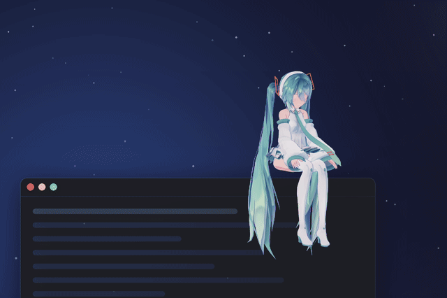
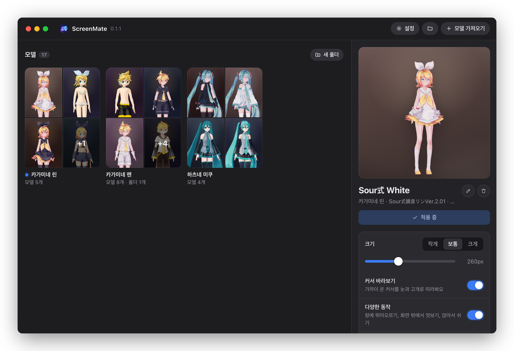
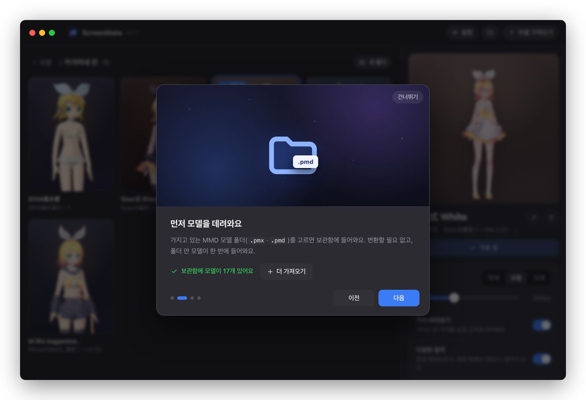
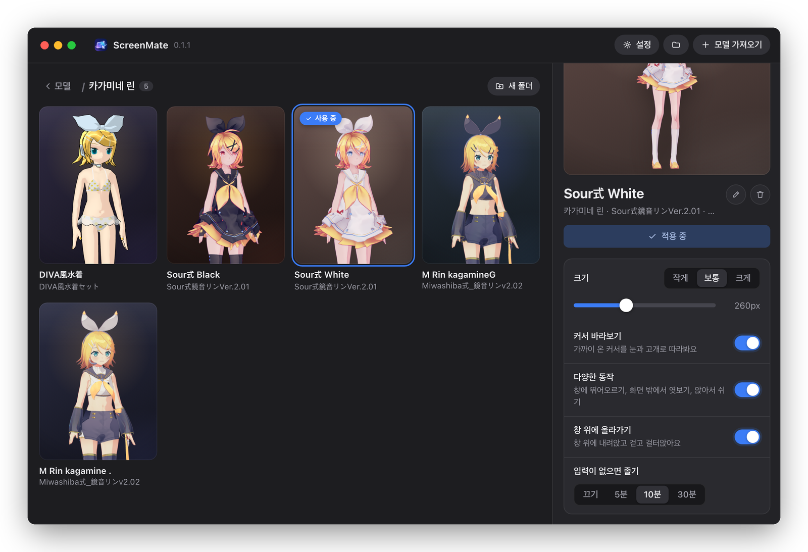
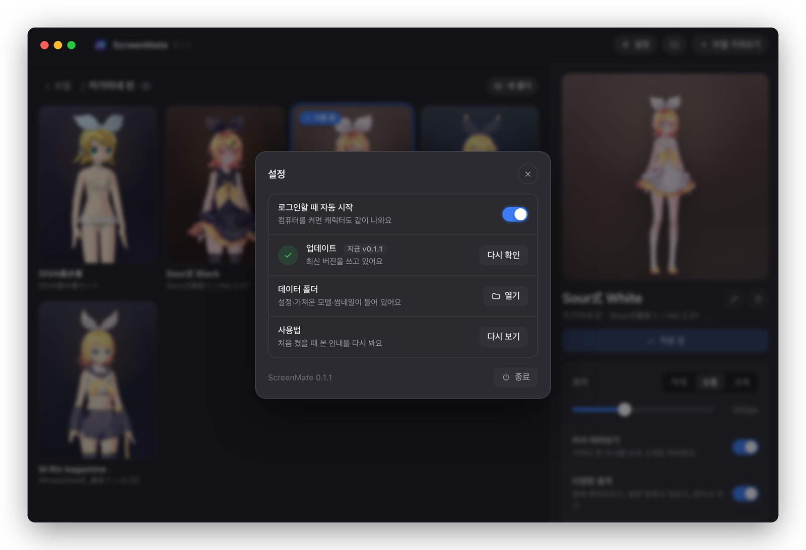
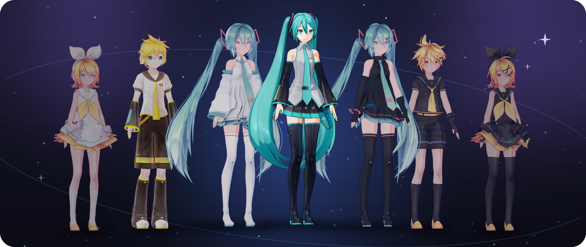

<p align="center">
  
</p>
<h1 align="center">ScreenMate</h1>

<p align="center">
  <b>바탕화면 위에서 살아 움직이는 나의 MMD 캐릭터 친구들</b><br>
</p>

<p align="center">
  <a href="https://github.com/sleeeppy/screenmate/releases/latest/download/ScreenMate-macos-universal.dmg"></a>
  <a href="https://github.com/sleeeppy/screenmate/releases/latest/download/ScreenMate-windows-setup.exe"></a>
</p>

<p align="center">
  <a href="https://github.com/sleeeppy/screenmate/releases/latest"></a>
  
  <a href="https://tauri.app"></a>
  <a href="https://github.com/noname0310/babylon-mmd"></a>
  
</p>

<p align="center">
  
</p>

---

<a id="features"></a>
<h3><picture><source media="(prefers-color-scheme: dark)" srcset="docs/images/headings/features-dark.png"></picture></h3>

<p align="center">
  
</p>
<p align="center"><b>창 테두리에 앉혀요</b></p>

<br>

<p align="center">
  
</p>
<p align="center"><b>잡아서 던져요</b></p>

<br>

<p align="center">
  
</p>
<p align="center"><b>가만두면 졸아요</b></p>

<br>

<h3><picture><source media="(prefers-color-scheme: dark)" srcset="docs/images/headings/quiet-dark.png"></picture></h3>

- 캐릭터가 그려진 곳에서만 클릭을 받고, 나머지는 아래 창으로 그대로 통과해요.
- 전체화면 게임·영상이 뜨면 숨어서 그리기와 물리를 멈춰요.
- 끌거나 던져서 옆 모니터로 보낼 수 있어요.
- 창 위치와 크기만 읽고, 화면 내용은 보지 않아요. 권한도 필요 없어요.

---

<a id="inapp"></a>
<h3><picture><source media="(prefers-color-scheme: dark)" srcset="docs/images/headings/inapp-dark.png"></picture></h3>

<p align="center">
  
</p>
<p align="center"><b>모델 보관함</b></p>

<p align="center">
  
</p>
<p align="center"><b>모델 가져오기</b></p>

<p align="center">
  
</p>
<p align="center"><b>캐릭터 옵션</b></p>

<p align="center">
  
</p>
<p align="center"><b>설정</b></p>

---

<a id="models"></a>
<h3><picture><source media="(prefers-color-scheme: dark)" srcset="docs/images/headings/models-dark.png"></picture></h3>

<p align="center">
  
</p>

- 가지고 있는 `.pmx`·`.pmd` 모델을 변환 없이 그대로 써요.
- 키, 팔 각도, 다리 길이를 모델마다 재서 같은 모션이 어느 모델에서나 자연스러워요.
- 모델에 든 MMD 물리로 머리카락과 치마가 흔들려요.

---

<a id="install"></a>
<h3><picture><source media="(prefers-color-scheme: dark)" srcset="docs/images/headings/install-dark.png"></picture></h3>

| 운영체제 | 내려받기 | 비고 |
|---|---|---|
| macOS 12 이상 | [ScreenMate-macos-universal.dmg](https://github.com/sleeeppy/screenmate/releases/latest/download/ScreenMate-macos-universal.dmg) | 애플 실리콘·인텔 모두 |
| Windows 10·11 | [ScreenMate-windows-setup.exe](https://github.com/sleeeppy/screenmate/releases/latest/download/ScreenMate-windows-setup.exe) | 관리자 권한 필요 없음 |

1. **설치하고 켜요.** ScreenMate 창과 함께 사용법 안내가 떠요.
2. **모델을 가져와요.** 오른쪽 위 **모델 가져오기**에서 `.pmx`·`.pmd`가 든 폴더를 고르면 바로 캐릭터가 나타나요.
3. **끝!** 그다음부터는 로그인할 때 같이 켜지고, 새 버전도 앱 안에서 받아요.

<details>
<summary>처음 열 때 경고가 떠요</summary>
<br>

서명하지 않은 앱이라 처음 한 번은 경고가 떠요.

- **macOS**: DMG의 ScreenMate를 응용 프로그램 폴더로 옮긴 뒤 열고, **시스템 설정 → 개인정보 보호 및 보안** 맨 아래의 **그래도 열기**를 눌러요.
- **Windows**: "Windows의 PC 보호" 창에서 **추가 정보 → 실행**을 눌러요. WebView2가 없으면 설치하면서 알아서 받아요.

</details>

---

<a id="faq"></a>
<h3><picture><source media="(prefers-color-scheme: dark)" srcset="docs/images/headings/faq-dark.png"></picture></h3>

<details>
<summary><b>캐릭터가 창 위에 안 올라가요</b></summary>
<br>

옵션의 **창 위에 올라가기**가 켜져 있는지 확인하세요. 머리 위 공간이 키보다 좁은 창(화면 맨 위에 붙은 창, 최대화한 창), 폭이 좁은 창, 앞 창에 가려진 테두리는 밟지 않아요.

</details>

<details>
<summary><b>캐릭터가 안 보여요</b></summary>
<br>

전체화면 앱이 떠 있으면 일부러 숨어요. 화면 밖에 나가 있을 때는 앱을 다시 실행하면 캐릭터가 하나 더 생기지 않고 ScreenMate 창이 열려요.

</details>

<details>
<summary><b>설정과 모델은 어디에 저장되나요?</b></summary>
<br>

- macOS: `~/Library/Application Support/dev.sleeeppy.screenmate`
- Windows: `%APPDATA%\dev.sleeeppy.screenmate`

설정(`settings.json`), 가져온 모델 사본(`models/`), 모델별 보정값(`profiles/`), 썸네일(`thumbnails/`)이 들어 있어요.

</details>

<details>
<summary><b>완전히 지우고 싶어요</b></summary>
<br>

설정에서 **로그인할 때 자동 시작**을 끄고 **종료**한 뒤, 앱과 위의 데이터 폴더를 지우세요.

</details>

---

<a id="build"></a>
<h3><picture><source media="(prefers-color-scheme: dark)" srcset="docs/images/headings/build-dark.png"></picture></h3>

Node.js와 Rust(stable)가 필요해요. Windows는 Visual Studio Build Tools(C++)와 WebView2, macOS는 Xcode Command Line Tools도 함께요.

```bash
npm install
npm run tauri dev       # 개발 실행
npm test                # 행동·모션 테스트
npx tauri build         # 설치 파일 (macOS .app·.dmg, Windows .exe)
```

`v`로 시작하는 태그를 올리면 [release 워크플로](https://github.com/sleeeppy/screenmate/actions/workflows/release.yml)가 macOS 유니버설 DMG와 Windows 설치 파일을 만들어 릴리스에 붙이고, 설치한 앱은 그 릴리스로 업데이트해요.

<details>
<summary>프로젝트 구조</summary>
<br>

| 경로 | 역할 |
|---|---|
| `src-tauri/` | Rust: 투명 창, 클릭 통과, 창 목록, 모델 가져오기, 설정, 업데이트 |
| `src/stage/` | Babylon.js 렌더링, 카메라, 클릭 판정, 빠른 메뉴 |
| `src/mmd/` | 모델 불러오기, 자동 보정, 표정 별칭, 물리 |
| `src/motion/` | 코드로 쓰는 모션(DSL)과 절차적 레이어 (숨쉬기, 시선, 깜빡임) |
| `src/behavior/` | 행동 상태 머신, 물리, 창 발판 |
| `src/settings/` | ScreenMate 창, 모델 보관함, 썸네일, 처음 켰을 때 안내 |
| `tools/` | VMD 내보내기, 설치 파일·README 그림 |
| `docs/PLAN.md` | 설계와 진행 기록 |

</details>

<details>
<summary>명령줄로 모델 한 번에 가져오기</summary>
<br>

앱은 `src-tauri`에서 실행되니 절대 경로로 넘겨요.

```bash
npx tauri dev -- -- --import "$PWD/models/Sour式鏡音リン・レンVer.2.01" "$PWD/models/YYB Hatsune Miku_default"
```

</details>

---

<p align="center">
  <a href="docs/CREDITS.md"><b>모델과 크레딧</b></a><br>
  <sub>初音ミク, 鏡音リン・レン © Crypton Future Media, INC. · 모델은 각 제작자분들의 작품이에요.</sub>
</p>
