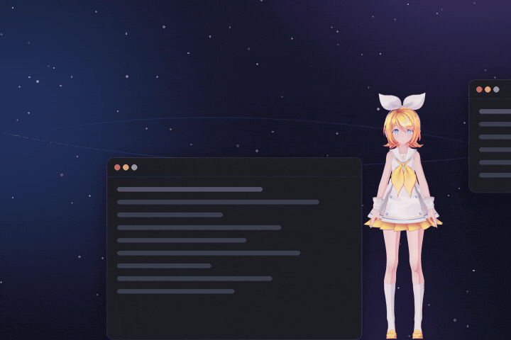
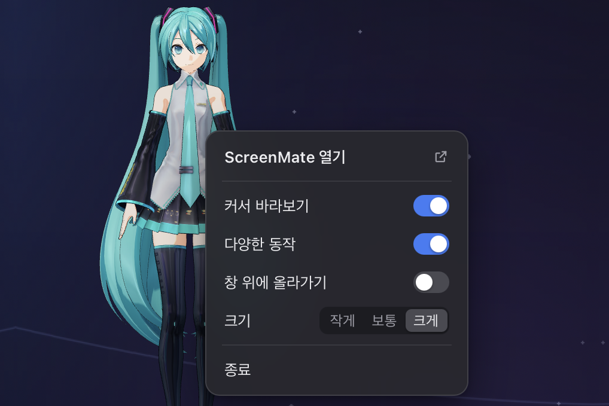

<p align="center">
  
</p>

<h3 align="center"><picture><source media="(prefers-color-scheme: dark)" srcset="docs/images/headings/title-dark.png"></picture></h3>

<p align="center">
  <b>바탕화면 위에서 살아 움직이는 MMD 데스크톱 메이트</b><br>
  걸어 다니다 창 위로 뛰어올라 걸터앉고, 잡히면 버둥거리고, 쓰다듬으면 웃어요.
</p>

<p align="center">
  <a href="https://github.com/sleeeppy/screenmate/releases/latest/download/ScreenMate-macos-universal.dmg"></a>
  <a href="https://github.com/sleeeppy/screenmate/releases/latest/download/ScreenMate-windows-setup.exe"></a>
</p>

<p align="center">
  <a href="https://github.com/sleeeppy/screenmate/releases/latest"></a>
  
  <a href="https://tauri.app"></a>
  <a href="https://github.com/noname0310/babylon-mmd"></a>
  
</p>

<p align="center">
  <a href="#features">주요 기능</a> ·
  <a href="#install">설치</a> ·
  <a href="#usage">사용법</a> ·
  <a href="#settings">설정</a> ·
  <a href="#models">모델</a> ·
  <a href="#faq">자주 묻는 질문</a> ·
  <a href="#build">직접 빌드하기</a>
</p>

<p align="center">
  
</p>

---

<a id="features"></a>
<h3><picture><source media="(prefers-color-scheme: dark)" srcset="docs/images/headings/features-dark.png"></picture></h3>

가지고 있는 MMD 모델을 그대로 불러와, 바탕화면을 제 집처럼 돌아다니게 해요. 모션은 모두 앱이 직접 만들어요. 따로 준비할 건 모델 하나뿐이에요.

<table>
  <tr>
    <td width="50%" valign="top">
      <br>
      <b>창 테두리에 앉혀요</b><br>
      엉덩이를 잡아 창 테두리에 대고 놓으면 그대로 걸터앉아 다리를 흔들어요. 창을 옮기면 같이 따라오고, 쓰다듬으면 앉은 채로 웃어요.
    </td>
    <td width="50%" valign="top">
      <br>
      <b>잡아서 던질 수 있어요</b><br>
      잡힌 곳에 매달려 흔들리고, 오래 들고 있거나 세게 흔들면 버둥거려요. 놓으면 그 속도 그대로 날아가 착지해요.
    </td>
  </tr>
  <tr>
    <td width="50%" valign="top">
      <br>
      <b>가만두면 꾸벅꾸벅 졸아요</b><br>
      한동안 아무것도 안 하면 그 자리에 앉아 졸아요. 커서가 다가오거나 누르면 깨고, 몸을 찌르면 놀라요.
    </td>
    <td width="50%" valign="top">
      <br>
      <b>우클릭하면 빠른 메뉴</b><br>
      캐릭터를 오른쪽 클릭하면 바로 옆에 작은 메뉴가 떠요. 자주 바꾸는 설정과 크기, 앱 열기가 한곳에 있어요.
    </td>
  </tr>
</table>

그 밖에도 커서가 다가오면 **눈과 고개로 따라보고**, 닿을 만한 창이 있으면 **폴짝 뛰어올라** 위를 걷다가 끝에서 뛰어내려요. 가끔은 **화면 밖으로 걸어 나갔다가 옆이나 아래에서 크게 빼꼼** 엿보고 돌아와요.

<br>

<h3><picture><source media="(prefers-color-scheme: dark)" srcset="docs/images/headings/quiet-dark.png"></picture></h3>

<table>
  <tr>
    <td width="50%" valign="top"><b>클릭은 그대로 통과</b><br>캐릭터가 그려진 픽셀 위에서만 마우스를 받아요. 바로 옆 빈 곳은 아래 창이 받아요.</td>
    <td width="50%" valign="top"><b>전체화면이면 숨어요</b><br>게임·영상을 전체화면으로 켜면 사라지고, 그리기와 물리도 멈춰요.</td>
  </tr>
  <tr>
    <td width="50%" valign="top"><b>모니터를 넘나들어요</b><br>끌거나 던져서 옆 모니터로 보내고, 마지막에 있던 모니터에서 다시 시작해요.</td>
    <td width="50%" valign="top"><b>화면을 보지 않아요</b><br>창 위치와 크기만 읽어요. 화면 기록 권한도 필요 없어요.</td>
  </tr>
</table>

---

<a id="install"></a>
<h3><picture><source media="(prefers-color-scheme: dark)" srcset="docs/images/headings/install-dark.png"></picture></h3>

| 운영체제 | 내려받기 | 비고 |
|---|---|---|
| macOS 12 이상 | [ScreenMate-macos-universal.dmg](https://github.com/sleeeppy/screenmate/releases/latest/download/ScreenMate-macos-universal.dmg) | 애플 실리콘·인텔 모두 |
| Windows 10·11 | [ScreenMate-windows-setup.exe](https://github.com/sleeeppy/screenmate/releases/latest/download/ScreenMate-windows-setup.exe) | 관리자 권한 필요 없음 |

1. **설치하고 켜요.** ScreenMate 창과 함께 사용법 안내가 떠요. 설치 파일에는 모델이 없어서 처음엔 바탕화면이 비어 있어요.
2. **모델을 가져와요.** 창 오른쪽 위 **모델 가져오기**에서 `.pmx`·`.pmd`가 든 폴더를 고르면 바로 캐릭터가 나타나요.
3. **끝!** 그다음부터는 로그인할 때 같이 켜지고, 새 버전도 앱 안에서 받아요.

<details>
<summary>처음 열 때 경고가 떠요</summary>
<br>

서명하지 않은 앱이라 처음 한 번은 경고가 떠요.

- **macOS**: DMG의 ScreenMate를 응용 프로그램 폴더로 옮긴 뒤 열고, **시스템 설정 → 개인정보 보호 및 보안** 맨 아래의 **그래도 열기**를 눌러요.
- **Windows**: "Windows의 PC 보호" 창에서 **추가 정보 → 실행**을 눌러요. WebView2가 없으면 설치하면서 알아서 받아요.

</details>

<a id="usage"></a>
<h3><picture><source media="(prefers-color-scheme: dark)" srcset="docs/images/headings/usage-dark.png"></picture></h3>

| 하고 싶은 것 | 방법 |
|---|---|
| 옮기기 · 던지기 | 캐릭터를 끌었다 놓기 |
| 쓰다듬기 · 찌르기 | 머리 · 몸을 누르기 |
| 빠른 메뉴 | 캐릭터를 오른쪽 클릭 |
| 설정 창 열기 | 빠른 메뉴의 **ScreenMate 열기**, 또는 앱 다시 실행 · Dock 아이콘 |
| 모델 바꾸기 | 설정 창에서 모델을 두 번 누르기 |
| 끄기 | 빠른 메뉴나 일반 설정의 **종료** |

캐릭터가 화면 밖에 있어 안 보일 때도 앱을 다시 실행하면 돼요. 캐릭터가 하나 더 생기지 않고 설정 창이 열려요.

---

<a id="settings"></a>
<h3><picture><source media="(prefers-color-scheme: dark)" srcset="docs/images/headings/settings-dark.png"></picture></h3>

<p align="center">
  
</p>

- **모델 보관함**: 가져온 모델이 캐릭터별 폴더로 정리돼요. 끌어서 폴더를 옮기고, F2로 이름을 바꾸고, Delete로 지워요.
- **캐릭터 설정**: 크기(160~440px), 커서 바라보기, 다양한 동작, 창 위에 올라가기, 입력이 없을 때 졸기(끄기·5·10·30분).
- **일반 설정**: 로그인할 때 자동 시작, 업데이트, 데이터 폴더, 사용법 다시 보기.
- **업데이트**: 새 버전이 나오면 일반 설정 버튼에 파란 점이 떠요. **지금 업데이트**를 누르면 받아서 다시 켜져요.

---

<a id="models"></a>
<h3><picture><source media="(prefers-color-scheme: dark)" srcset="docs/images/headings/models-dark.png"></picture></h3>

<p align="center">
  
</p>

`.pmx`·`.pmd` 모델을 변환 없이 그대로 써요. 폴더를 고르면 안의 모델이 모두 등록되고, 썸네일과 옷 색으로 칠한 카드가 만들어져요.

- **모델마다 자동으로 맞춰요**: 키, 팔 기본 각도, 다리 길이를 재서 같은 모션이 어느 모델에서나 자연스럽게 보여요. 표정 모프 이름이 달라도 알아서 찾아요.
- **물리도 그대로**: 모델에 든 MMD 물리(Bullet)로 머리카락과 치마가 흔들려요.
- **깨진 파일 이름은 되돌려요**: 일본어 zip을 한국어 Windows에서 풀어 `떮돶깏깛_DIVA븮릣뭶.pmd`처럼 깨진 이름을 `鏡音リン_DIVA風水着.pmd`로 고쳐 가져와요.

---

<a id="faq"></a>
<h3><picture><source media="(prefers-color-scheme: dark)" srcset="docs/images/headings/faq-dark.png"></picture></h3>

<details>
<summary><b>캐릭터가 창 위에 안 올라가요</b></summary>
<br>

설정의 **창 위에 올라가기**가 켜져 있는지 확인하세요. 머리 위 공간이 키보다 좁은 창(화면 맨 위에 붙은 창, 최대화한 창), 폭이 좁은 창, 앞 창에 가려진 테두리는 밟지 않아요.

</details>

<details>
<summary><b>게임을 켰더니 캐릭터가 사라졌어요</b></summary>
<br>

전체화면 앱이 떠 있으면 일부러 숨어요. 전체화면을 끄면 멈췄던 자리에서 다시 움직여요.

</details>

<details>
<summary><b>설정과 모델은 어디에 저장되나요?</b></summary>
<br>

- macOS: `~/Library/Application Support/dev.sleeeppy.screenmate`
- Windows: `%APPDATA%\dev.sleeeppy.screenmate`

설정(`settings.json`), 가져온 모델 사본(`models/`), 모델별 보정값(`profiles/`), 썸네일(`thumbnails/`)이 들어 있어요. 보정값은 `profiles/<모델 id>.json`을 고쳐 직접 바꿀 수 있어요.

</details>

<details>
<summary><b>완전히 지우고 싶어요</b></summary>
<br>

일반 설정에서 **로그인할 때 자동 시작**을 끄고 **종료**한 뒤, 앱과 위의 데이터 폴더를 지우세요.

</details>

---

<a id="build"></a>
<h3><picture><source media="(prefers-color-scheme: dark)" srcset="docs/images/headings/build-dark.png"></picture></h3>

Node.js와 Rust(stable)가 필요해요. Windows는 Visual Studio Build Tools(C++)와 WebView2, macOS는 Xcode Command Line Tools도 함께요.

```bash
npm install
npm run tauri dev       # 개발 실행
npm test                # 행동·모션 테스트
npx tauri build         # 설치 파일 (macOS .app·.dmg, Windows .exe)
```

`v`로 시작하는 태그를 올리면 [release 워크플로](https://github.com/sleeeppy/screenmate/actions/workflows/release.yml)가 macOS 유니버설 DMG와 Windows 설치 파일을 만들어 릴리스에 붙이고, 설치한 앱은 그 릴리스로 업데이트해요.

<details>
<summary>프로젝트 구조</summary>
<br>

| 경로 | 역할 |
|---|---|
| `src-tauri/` | Rust: 투명 창, 클릭 통과, 창 목록, 모델 가져오기, 설정, 업데이트 |
| `src/stage/` | Babylon.js 렌더링, 카메라, 클릭 판정, 빠른 메뉴 |
| `src/mmd/` | 모델 불러오기, 자동 보정, 표정 별칭, 물리 |
| `src/motion/` | 코드로 쓰는 모션(DSL)과 절차적 레이어 (숨쉬기, 시선, 깜빡임) |
| `src/behavior/` | 행동 상태 머신, 물리, 창 발판 |
| `src/settings/` | 설정 창, 모델 보관함, 썸네일, 처음 켰을 때 안내 |
| `tools/` | VMD 내보내기, 설치 파일·README 그림 |
| `docs/PLAN.md` | 설계와 진행 기록 |

</details>

<details>
<summary>명령줄로 모델 한 번에 가져오기</summary>
<br>

앱은 `src-tauri`에서 실행되니 절대 경로로 넘겨요.

```bash
npx tauri dev -- -- --import "$PWD/models/Sour式鏡音リン・レンVer.2.01" "$PWD/models/YYB Hatsune Miku_default"
```

</details>

---

<h3><picture><source media="(prefers-color-scheme: dark)" srcset="docs/images/headings/credits-dark.png"></picture></h3>

README의 그림과 `models/`의 모델은 아래 제작자분들의 작품이에요. 이용 약관은 각 모델 폴더의 readme를 따르고, 상업적으로 이용할 수 없어요.

| 모델 | 제작 |
|---|---|
| Sour式 初音ミク · 鏡音リン · 鏡音レン | Sour暄 |
| YYB式 鏡音レン, YYB Hatsune Miku | YYB |
| DIVA風水着セット | ブライアン成田 |
| もにた式 初音ミク · 鏡音レン | もにた |
| Miwashiba式 鏡音リン · 鏡音レン | Miwashiba |
| 鏡音レン (gasl) | gasl (VRoid Hub의 VRM을 이 앱용으로 PMX 변환) |

初音ミク, 鏡音リン・レン © Crypton Future Media, INC. [piapro](https://piapro.net) — [피아프로 캐릭터 라이선스](https://piapro.jp/license/character_guideline)를 따릅니다.

<p align="center"><sub>모델 렌더링은 <a href="https://github.com/noname0310/babylon-mmd">babylon-mmd</a>, 앱 껍데기는 <a href="https://tauri.app">Tauri 2</a>로 만들었어요.</sub></p>
