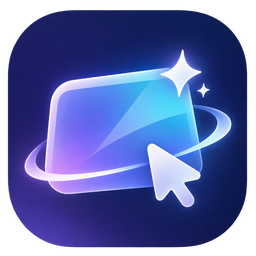
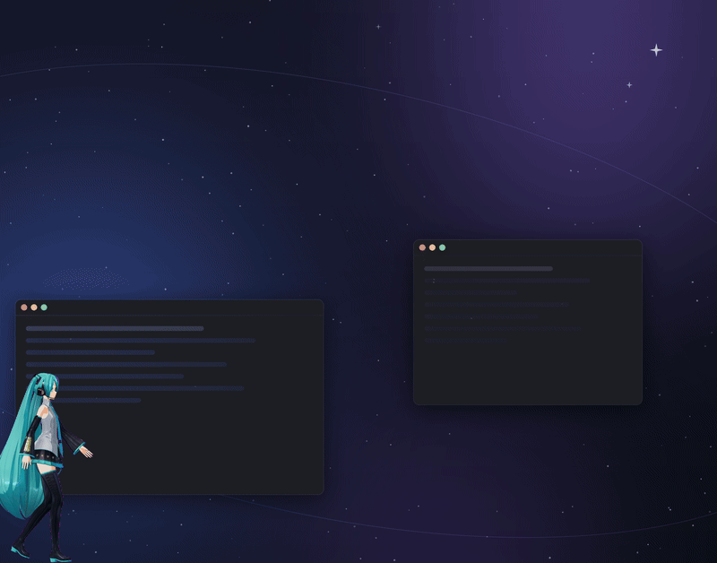
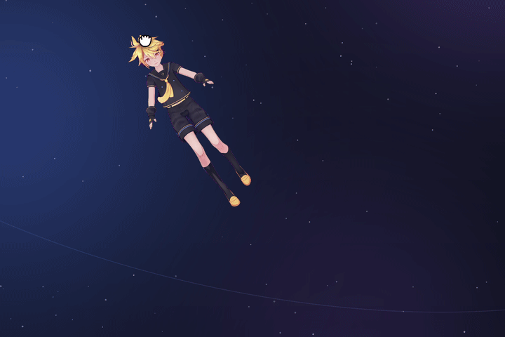
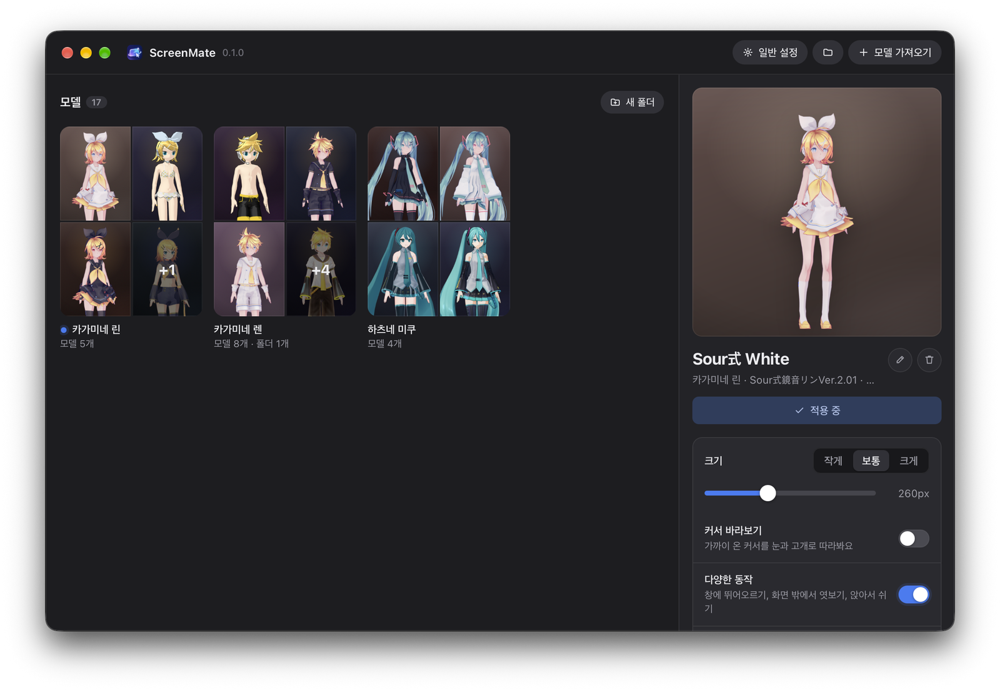

<p align="center">
  
</p>

<h3 align="center"><picture><source media="(prefers-color-scheme: dark)" srcset="docs/images/headings/title-dark.png"></picture></h3>

<p align="center">
  바탕화면 위를 걸어 다니는 MMD 데스크톱 메이트.<br>
  창 위에 올라가 앉고, 잡아서 던지고, 쓰다듬을 수 있어요.
</p>

<p align="center">
  <a href="https://github.com/sleeeppy/screenmate/releases/latest/download/ScreenMate-macos-universal.dmg"></a>
  <a href="https://github.com/sleeeppy/screenmate/releases/latest/download/ScreenMate-windows-setup.exe"></a>
</p>

<p align="center">
  <a href="https://github.com/sleeeppy/screenmate/releases/latest"></a>
  
</p>

<p align="center">
  
</p>

---

### 시작하기

1. **설치하고 켜면** ([macOS](https://github.com/sleeeppy/screenmate/releases/latest/download/ScreenMate-macos-universal.dmg) · [Windows](https://github.com/sleeeppy/screenmate/releases/latest/download/ScreenMate-windows-setup.exe)) ScreenMate 창과 함께 사용법 안내가 떠요. 설치 파일에는 모델이 없어서 처음엔 바탕화면이 비어 있어요.
2. **모델 가져오기**: 창 오른쪽 위 **모델 가져오기**를 누르고 `.pmx`·`.pmd`가 든 폴더를 고르면, 바로 바탕화면에 캐릭터가 나타나요.
3. **캐릭터를 오른쪽 클릭**하면 빠른 메뉴가 열려요. **ScreenMate 열기**로 언제든 이 창을 다시 열고, 다른 모델로 바꾸거나 모델을 더 가져올 수 있어요.

캐릭터가 화면 밖에 나가 있거나 안 보일 때는 Dock의 ScreenMate 아이콘을 누르거나 앱을 다시 실행하세요. (Windows는 시작 메뉴에서 다시 실행) 캐릭터가 하나 더 생기지 않고 ScreenMate 창이 열려요.

<br/>

### 바탕화면을 돌아다녀요

걷고, 두리번거리고, 기지개를 켜고, 바닥에 앉아 쉬어요. 커서가 가까이 오면 눈과 고개로 따라봐요. <br/>
가끔은 화면 밖으로 걸어 나갔다가 옆이나 아래에서 빼꼼 엿보고 다시 들어와요.

닿을 만한 창이 있으면 그 아래로 걸어가 웅크렸다가 폴짝 뛰어올라요. 창 위를 걷다가 끝에서 뛰어내리기도 해요.

<br/>

### 창 테두리에 걸터앉아요

창 위에서는 테두리에 걸터앉아 다리를 늘어뜨려요. 앉은 채로 창을 옮기면 같이 따라오고, <br/>
창을 닫거나 최소화하면 떨어져서 바닥에 착지해요. 다른 창에 가려진 부분은 밟지 않아요.

<p align="center">
  
</p>

<br/>

### 잡아서 던질 수 있어요

캐릭터를 끌면 잡힌 곳에 매달려 흔들려요. 오래 들고 있거나 세게 흔들면 버둥거려요. <br/>
놓으면 그 속도 그대로 날아가 착지하고, 창 테두리 근처에서 살짝 놓으면 바로 걸터앉아요.

<p align="center">
  
</p>

<br/>

### 가만히 두면 졸아요

한동안 아무것도 하지 않으면(기본 10분) 그 자리에 앉아 꾸벅꾸벅 졸아요. 커서가 다가오거나 누르면 깨요. <br/>
머리를 누르면 쓰다듬기, 몸을 누르면 찌르기 반응을 해요. 앉아 있을 때 쓰다듬으면 앉은 채로 웃어요.

<p align="center">
  
</p>

<br/>

### 우클릭하면 빠른 메뉴

캐릭터를 오른쪽 클릭하면 바로 옆에 작은 메뉴가 열려요. 설정 창을 열고, 자주 바꾸는 설정을 켜고 끄고, 크기를 고를 수 있어요.

<p align="center">
  
</p>

<br/>

### 방해하지 않아요

- **클릭은 그대로 통과해요**: 캐릭터가 그려진 픽셀 위에서만 마우스를 받고, 나머지는 아래 창으로 넘어가요.
- **전체화면에서는 숨어요**: 게임이나 영상을 전체화면으로 켜면 캐릭터가 사라지고, 그리기도 멈춰요.
- **모니터를 넘나들어요**: 끌거나 던져서 옆 모니터로 보낼 수 있고, 마지막에 있던 모니터에서 다시 시작해요.
- **로그인할 때 같이 켜져요**: 설치한 앱을 처음 켜면 자동 시작이 켜져요. 일반 설정에서 끌 수 있어요.

---

<h3><picture><source media="(prefers-color-scheme: dark)" srcset="docs/images/headings/settings-dark.png"></picture></h3>

캐릭터를 오른쪽 클릭한 빠른 메뉴의 **ScreenMate 열기**로 엽니다. 앱을 다시 실행하거나 Dock 아이콘을 눌러도 열려요.

<p align="center">
  
</p>

- **모델 보관함**: 가져온 모델이 캐릭터별 폴더로 정리돼요. 폴더 카드에는 안에 든 모델이 모자이크로 보여요.
  두 번 누르면 바로 바꾸고, 끌어서 다른 폴더로 옮기거나 새 폴더를 만들 수 있어요. 이름 바꾸기는 F2, 지우기는 Delete.
- **오른쪽 패널**: 고른 모델의 전신 미리보기와 **이 모델 쓰기**(return), 그리고 캐릭터 설정이 있어요.
  - **크기**: 작게·보통·크게, 또는 슬라이더로 160~440px.
  - **커서 바라보기**: 가까이 온 커서를 눈과 고개로 따라봐요.
  - **다양한 동작**: 창에 뛰어오르기, 화면 밖에서 엿보기, 앉아서 쉬기. 끄면 걷고 서 있기만 해요.
  - **창 위에 올라가기**: 끄면 바닥에서만 지내요.
  - **입력이 없으면 졸기**: 끄기·5분·10분·30분.
- **일반 설정**: 로그인할 때 자동 시작, 업데이트, 데이터 폴더 열기, 사용법 다시 보기, 버전, 종료.
- **업데이트**: 설정 창을 열 때마다 새 버전이 있는지 확인해요. 새 버전이 있으면 **일반 설정** 버튼에 파란 점이 뜨고,
  업데이트 줄에 **지금 업데이트**가 나와요. 누르면 받는 만큼 진행 막대가 차고, 앱이 꺼졌다가 새 버전으로 다시 켜져요.
  최신이면 초록 체크, 문제가 있으면 빨간 표시와 이유가 보이고 **다시 확인**·**다시 시도**로 바로 다시 확인할 수 있어요.

키보드로도 다룰 수 있어요. esc는 한 단계 위로, ←→는 모델 넘기기, return은 고른 모델 쓰기, ⌘/Ctrl + A는 전부 고르기예요.

---

<h3><picture><source media="(prefers-color-scheme: dark)" srcset="docs/images/headings/models-dark.png"></picture></h3>

<p align="center">
  
</p>

가지고 있는 MMD 모델(`.pmx`, `.pmd`)을 그대로 씁니다. 변환하지 않아요.

1. 설정 창 오른쪽 위 **모델 가져오기**를 누릅니다.
2. `.pmx`·`.pmd`가 들어 있는 폴더를 고릅니다. 폴더 안 모델이 모두 등록되고, readme도 같이 보관돼요.
3. 설정 창이 모델마다 썸네일을 찍고, 옷 색을 뽑아 카드 배경을 칠해요.

- **깨진 파일 이름은 저절로 고쳐요**: 일본어 zip을 한국어 Windows에서 풀면 `떮돶깏깛_DIVA븮릣뭶.pmd`처럼 깨지는데, 가져올 때 `鏡音リン_DIVA風水着.pmd`로 되돌려요.
- **모델마다 자동으로 맞춰요**: 키, 팔 기본 각도, 다리 길이를 재서 같은 모션이 어느 모델에서나 자연스럽게 보이게 해요. 표정 모프 이름이 달라도 알아서 찾아요.
- **물리도 그대로**: 모델에 들어 있는 MMD 물리(Bullet)로 머리카락과 치마가 흔들려요.

보정값을 직접 고치려면 데이터 폴더의 `profiles/<모델 id>.json`을 수정하세요.

---

<h3><picture><source media="(prefers-color-scheme: dark)" srcset="docs/images/headings/faq-dark.png"></picture></h3>

<details>
<summary><b>캐릭터가 창 위에 안 올라가요</b></summary>
<br>

설정의 **창 위에 올라가기**가 켜져 있는지 확인하세요. 머리 위 공간이 키보다 좁은 창(화면 맨 위에 붙은 창, 최대화한 창)과 폭이 좁은 창은 발판으로 쓰지 않아요. 앞 창에 가려진 테두리도 밟지 않아요.

</details>

<details>
<summary><b>게임을 켰더니 캐릭터가 사라졌어요</b></summary>
<br>

전체화면 앱이 떠 있으면 일부러 숨어요. 전체화면을 끄면 멈췄던 자리에서 다시 움직여요. 숨어 있는 동안은 그리기와 물리를 모두 멈춰서 컴퓨터 자원을 거의 쓰지 않아요.

</details>

<details>
<summary><b>캐릭터 때문에 뒤에 있는 걸 못 눌러요</b></summary>
<br>

캐릭터가 실제로 그려진 픽셀 위에서만 마우스를 받아요. 캐릭터 옆 빈 곳은 아래 창으로 그대로 넘어가요. 거슬리면 끌어서 다른 데로 옮기거나 크기를 줄이세요.

</details>

<details>
<summary><b>macOS에서 권한이 필요한가요?</b></summary>
<br>

아니요. 창 위치는 화면 기록 권한 없이 읽을 수 있는 창 목록(위치와 크기)만 씁니다. 화면 내용을 찍거나 보내지 않아요.

</details>

<details>
<summary><b>설정과 모델은 어디에 저장되나요?</b></summary>
<br>

- macOS: `~/Library/Application Support/dev.sleeeppy.screenmate`
- Windows: `%APPDATA%\dev.sleeeppy.screenmate`

`settings.json`(설정), `models/`(가져온 모델 사본), `profiles/`(모델별 보정값), `thumbnails/`(설정 창 썸네일)이 들어 있어요. 일반 설정 → **데이터 폴더**로 바로 열 수 있어요.

</details>

<details>
<summary><b>완전히 지우고 싶어요</b></summary>
<br>

1. 일반 설정에서 **로그인할 때 자동 시작**을 끄고 **종료**를 누릅니다.
2. 앱을 지웁니다. (macOS는 휴지통으로, Windows는 설정 → 앱에서 제거)
3. 위의 데이터 폴더를 지웁니다.

</details>

---

<a id="install"></a>
<h3><picture><source media="(prefers-color-scheme: dark)" srcset="docs/images/headings/install-dark.png"></picture></h3>

| 운영체제 | 내려받기 | 비고 |
|---|---|---|
| macOS 12 이상 | [ScreenMate-macos-universal.dmg](https://github.com/sleeeppy/screenmate/releases/latest/download/ScreenMate-macos-universal.dmg) | 애플 실리콘·인텔 모두 |
| Windows 10·11 | [ScreenMate-windows-setup.exe](https://github.com/sleeeppy/screenmate/releases/latest/download/ScreenMate-windows-setup.exe) | 사용자별 설치, 관리자 권한 필요 없음 |

이전 버전과 바뀐 내용은 [릴리스 페이지](https://github.com/sleeeppy/screenmate/releases)에 있어요. 설치 파일에는 모델이 들어 있지 않으니, 설치한 뒤 가지고 있는 모델을 가져오세요.

**macOS**: DMG를 열고 ScreenMate를 응용 프로그램 폴더로 끌어다 놓습니다.
서명하지 않은 앱이라 처음 열면 "확인할 수 없다"는 경고가 떠요. **시스템 설정 → 개인정보 보호 및 보안** 맨 아래의 **그래도 열기**를 누르면 그다음부터는 바로 열려요.

**Windows**: 설치 파일을 실행합니다. "Windows의 PC 보호" 창이 뜨면 **추가 정보 → 실행**을 누르세요. WebView2가 없으면 설치하면서 알아서 받아요.

한 번 설치하면 그다음부터는 앱 안에서 업데이트해요. (일반 설정 → 업데이트)

---

<h3><picture><source media="(prefers-color-scheme: dark)" srcset="docs/images/headings/usage-dark.png"></picture></h3>

| 하고 싶은 것 | 방법 |
|---|---|
| 옮기기, 던지기 | 캐릭터를 끌었다 놓아요 |
| 쓰다듬기 | 머리를 눌러요 |
| 찌르기 | 몸을 눌러요 |
| 빠른 메뉴 | 캐릭터를 오른쪽 클릭 |
| 설정 창 열기 | 빠른 메뉴의 **ScreenMate 열기**, 또는 앱 다시 실행·Dock 아이콘 |
| 모델 가져오기 | 설정 창 오른쪽 위 **모델 가져오기** → `.pmx`·`.pmd`가 든 폴더 |
| 모델 바꾸기 | 설정 창에서 모델을 두 번 눌러요 |
| 크기 바꾸기 | 빠른 메뉴나 설정 창의 **크기** |
| 끄기 | 빠른 메뉴나 일반 설정의 **종료** |

---

<h3><picture><source media="(prefers-color-scheme: dark)" srcset="docs/images/headings/build-dark.png"></picture></h3>

Node.js와 Rust(stable)가 필요합니다.

- Windows: Visual Studio Build Tools (C++ 데스크톱 워크로드), WebView2
- macOS: Xcode Command Line Tools

```bash
npm install
npm run tauri dev       # 개발 실행
npm test                # 행동·모션 테스트
npx tauri build         # 설치 파일 (macOS .app·.dmg, Windows .exe)
```

릴리스는 GitHub Actions가 만들어요. `package.json`·`src-tauri/Cargo.toml`·`src-tauri/tauri.conf.json`의 버전을 올리고 `v`로 시작하는 태그를 올리면,
[release 워크플로](https://github.com/sleeeppy/screenmate/actions/workflows/release.yml)가 macOS 유니버설 DMG와 Windows 설치 파일을 만들어 릴리스에 붙여요.
설치한 앱은 이 릴리스를 보고 앱 안에서 업데이트해요.

`models/`의 모델을 명령줄로 한 번에 가져올 수도 있어요. 앱은 `src-tauri`에서 실행되니 절대 경로로 넘깁니다.

```bash
npx tauri dev -- -- --import "$PWD/models/Sour式鏡音リン・レンVer.2.01" "$PWD/models/YYB Hatsune Miku_default"
```

| 경로 | 역할 |
|---|---|
| `src-tauri/` | Rust: 투명 창, 클릭 통과, 창 목록, 모델 가져오기, 설정, 업데이트 |
| `src/stage/` | Babylon.js 렌더링, 카메라, 클릭 판정, 빠른 메뉴 |
| `src/mmd/` | 모델 불러오기, 자동 보정, 표정 별칭, 물리 |
| `src/motion/` | 코드로 쓰는 모션(DSL)과 절차적 레이어 (숨쉬기, 시선, 깜빡임) |
| `src/behavior/` | 행동 상태 머신, 물리, 창 발판 |
| `src/settings/` | 설정 창, 모델 보관함, 썸네일, 처음 켰을 때 안내 |
| `tools/` | VMD 내보내기, 설치 파일·README 그림 |
| `docs/PLAN.md` | 설계와 진행 기록 |

모델 렌더링은 [babylon-mmd](https://github.com/noname0310/babylon-mmd), 앱 껍데기는 [Tauri 2](https://tauri.app)로 만들었어요.

---

<h3><picture><source media="(prefers-color-scheme: dark)" srcset="docs/images/headings/credits-dark.png"></picture></h3>

README의 그림과 `models/`의 모델은 아래 제작자분들의 작품이에요. 이용 약관은 각 모델 폴더의 readme를 따르고, 상업적 이용은 할 수 없어요.

| 모델 | 제작 |
|---|---|
| Sour式 初音ミク · 鏡音リン · 鏡音レン | Sour暄 |
| YYB式 鏡音レン, YYB Hatsune Miku | YYB |
| DIVA風水着セット | ブライアン成田 |
| もにた式 初音ミク · 鏡音レン | もにた |
| Miwashiba式 鏡音リン · 鏡音レン | Miwashiba |
| 鏡音レン (gasl) | gasl (VRoid Hub의 VRM을 이 앱용으로 PMX 변환) |

初音ミク, 鏡音リン・レン © Crypton Future Media, INC. [piapro](https://piapro.net) — [피아프로 캐릭터 라이선스](https://piapro.jp/license/character_guideline)를 따릅니다.
